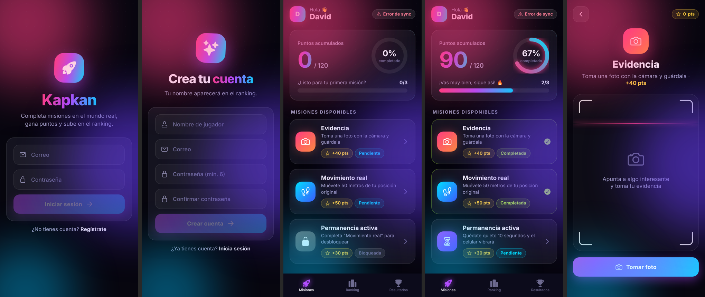
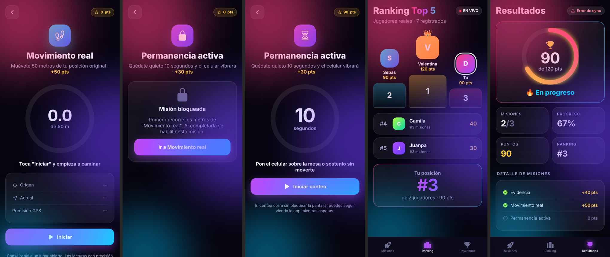
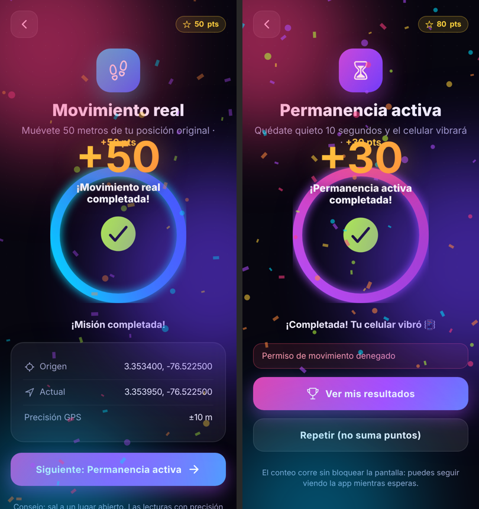

# Kapkan — Parcial 2

App en **Ionic + React + Capacitor + Firebase** donde los usuarios se registran, completan misiones del mundo real con los sensores del celular, ganan puntos y compiten en un ranking en vivo.





---

## Cómo cumple cada requisito del parcial

| Requisito | Dónde está |
|---|---|
| Usuarios reales: login y registro | `hooks/useAuth.ts`, `pages/Login.tsx`, `pages/Register.tsx` (Firebase Auth) |
| Pantalla principal con misiones, estado (pendiente/completada) y puntos | `pages/Missions.tsx`, `components/MissionCard.tsx` |
| **Misión 1 – Evidencia:** foto con la cámara, se completa al guardar | `pages/MissionPhoto.tsx` (`@capacitor/camera` + `@capacitor/filesystem`) |
| **Misión 2 – Movimiento real:** detecta cambio de ubicación | `pages/MissionMove.tsx`, `hooks/useGeolocation.ts`, `utils/geo.ts` (Haversine) |
| **Misión 3 – Permanencia activa:** se habilita tras la 2, 10 s quieto y vibra, sin bloquear | `pages/MissionStill.tsx`, `hooks/useStillTimer.ts` (acelerómetro), `hooks/useVibration.ts` |
| Sistema de puntos y total acumulado | `config/missions.ts` (40 + 50 + 30 = 120), `context/ProgressContext.tsx` |
| Barra de progreso: % y completadas/total | `pages/Missions.tsx` (barra + anillo) |
| Persistencia en Firebase **y** local con el formato pedido | `context/ProgressContext.tsx` → `{ "points": 120, "missions": [{ "id": 1, "completed": true }] }` |
| Pantalla de resultados: puntos, misiones, estado general | `pages/Results.tsx` |
| API: enviar puntos a Firebase | `ProgressContext.saveRemote` (automático) + botón "Enviar puntos a Firebase" |
| Notificaciones locales: "Has completado una misión" y "Te falta 1 misión para completar" | `hooks/useLocalNotifications.ts`, llamadas en `completeMission` |
| Ranking: Top 5 usuarios reales con puntaje real, posicionándote frente a los otros | `hooks/useRanking.ts` (en vivo con `onSnapshot`), `pages/Ranking.tsx` |
| Hooks y manejo de estado | Custom hooks en `hooks/`, contextos `AuthContext` y `ProgressContext` |
| Capacitor: Camera, Geolocation, Haptics (vibrador), Local Notifications, Motion (acelerómetro) | Ver `package.json` |

**Ranking:** si estás dentro del Top 5 se muestra tal cual. Si no, se muestran los 4 primeros y tú con tu posición real (por ejemplo #9), así siempre te ves frente a los demás.

---

## Paso 1 · Configurar Firebase (10 min)

Puedes usar un proyecto nuevo o el mismo de los challenges.

1. **Authentication** → Comenzar → Método de acceso → **Correo electrónico/contraseña** → Habilitar → Guardar.
2. **Firestore Database** → Crear base de datos → ubicación `nam5` → *modo de producción* → Crear.
3. En Firestore → pestaña **Reglas** → borra todo, pega el contenido de `firestore.rules` → **Publicar**.
4. **Configuración del proyecto** (engranaje) → Tus apps → `</>` Web → registra la app → copia el `firebaseConfig`.

## Paso 2 · Crear el `.env`

En la carpeta del proyecto (junto a `package.json`), copia `.env.example` como `.env` y llena los valores **sin comillas**:

```
VITE_FIREBASE_API_KEY=AIza...
VITE_FIREBASE_AUTH_DOMAIN=tu-proyecto.firebaseapp.com
VITE_FIREBASE_PROJECT_ID=tu-proyecto
VITE_FIREBASE_STORAGE_BUCKET=tu-proyecto.firebasestorage.app
VITE_FIREBASE_MESSAGING_SENDER_ID=123456789
VITE_FIREBASE_APP_ID=1:123456789:web:abc
VITE_DEMO_MODE=false
```

> Vite solo lee el `.env` al arrancar: si lo cambias, detén `npm run dev` con Ctrl+C y vuelve a ejecutarlo.

## Paso 3 · Probar en el PC

```bash
npm install
npm run dev
```

Abre `http://localhost:5173`, regístrate y prueba. En el PC funcionan login, cámara (webcam), GPS aproximado, puntos, ranking, resultados y notificaciones del navegador.

**Modo demo:** en un PC no puedes caminar 50 m ni hay acelerómetro. Pon `VITE_DEMO_MODE=true` en el `.env` y reinicia: aparecen botones "Simular +10 m" y "Simular que me muevo". **Para la entrega, déjalo en `false`.**

## Paso 4A · Publicar en Netlify y abrir en el celular (sin cables)

1. En el `.env` pon `VITE_DEMO_MODE=false`.
2. `npm run build` → se crea la carpeta `dist`.
3. Entra a https://app.netlify.com/drop (inicia sesión) y **arrastra la carpeta `dist`**.
4. Netlify te da un link `https://algo.netlify.app`. Ábrelo en el **Chrome del celular**.
5. En Firebase → Authentication → **Configuración → Dominios autorizados** → agrega `algo.netlify.app`.

En Android (Chrome) funcionan cámara, GPS, acelerómetro, vibración y notificaciones. En iPhone (Safari) **no** hay vibración desde la web.
Cada vez que cambies código: `npm run build` y vuelve a arrastrar `dist` en la sección *Deploys* de tu sitio.

## Paso 4B · App nativa Android (opcional)

Necesitas **Android Studio** y un celular con **Depuración USB** activada (Ajustes → Acerca del teléfono → toca 7 veces "Número de compilación" → Opciones de desarrollador → Depuración USB).

```bash
npm run build
npx cap add android        # solo la primera vez
npm run android:perms      # agrega permisos de cámara, GPS, vibración y notificaciones
npx cap sync android
npx cap open android
```

En Android Studio conecta el celular por USB, elígelo arriba y dale **Run ▶**. Cada vez que cambies código: `npm run build` y `npx cap sync android`, y otra vez Run.

---

## Checklist de pruebas

- [ ] Registro con nombre, correo y contraseña → entra a Misiones.
- [ ] En Firestore aparece `users/{uid}` con `points: 0`.
- [ ] **Evidencia:** Tomar foto → Guardar evidencia → confeti, +40, notificación "Has completado una misión".
- [ ] **Permanencia** aparece **bloqueada** hasta completar Movimiento.
- [ ] **Movimiento:** Iniciar → camina al aire libre → al pasar 50 m se completa (+50) y llega "Te falta 1 misión para completar".
- [ ] **Permanencia:** Iniciar conteo → si mueves el celular se reinicia → 10 s quieto → **vibra**, +30.
- [ ] Barra de progreso: 0% → 33% → 67% → 100% y 0/3 → 3/3.
- [ ] **Resultados:** 120 pts, 3/3, "¡Completado!", foto de evidencia y JSON guardado.
- [ ] **Ranking:** registra otras cuentas (otra pestaña en incógnito), completa misiones con ellas y mira cómo cambia en vivo.
- [ ] Cierra sesión y vuelve a entrar: el progreso sigue (Firebase). Sin internet también se ve (local).

---

## Decisiones tomadas (por ambigüedades del enunciado)

- **Distancia:** el enunciado dice "50 metros" y en otra parte "distancia > 30 m". Se usa **50 m** (coincide con el nombre de la misión y con la misión 3). Se cambia en `src/config/missions.ts` → `MOVE_TARGET_METERS`.
- **GPS:** se ignoran lecturas con precisión peor a ±40 m para evitar que el ruido del GPS complete la misión sin moverse (`MAX_GPS_ACCURACY_METERS`).
- **"Quieto":** se valida con el acelerómetro; si detecta movimiento el conteo vuelve a 10. Si el dispositivo no tiene acelerómetro (PC), solo cuenta el tiempo.
- **"Sin bloquear pantalla":** el conteo usa un intervalo, no un `alert` ni un bucle que congele la app.
- **Foto:** se guarda completa en el almacenamiento del dispositivo (`Filesystem`) y una miniatura en local. No se sube a Firebase Storage porque en el plan gratuito requiere tarjeta.
- **Puntos:** 40 + 50 + 30 = 120 (coincide con el ejemplo `"points": 120`).

## Estructura

```
src/
├── config/        firebase.ts, missions.ts (puntos y parámetros)
├── context/       AuthContext.tsx, ProgressContext.tsx (estado + Firebase + local)
├── hooks/         useAuth, useCamera, useGeolocation, useAccelerometer, useStillTimer,
│                  useVibration, useLocalNotifications, useRanking, useCountUp
├── components/    Aurora, MissionCard, ProgressRing, Confetti, TopBar, SyncChip
├── pages/         Login, Register, Tabs, Missions, MissionPhoto, MissionMove,
│                  MissionStill, Ranking, Results
├── theme/         global.css
└── utils/         geo.ts (Haversine), image.ts, storage.ts
firestore.rules    reglas de seguridad para pegar en Firebase
scripts/           android-permissions.mjs
```
